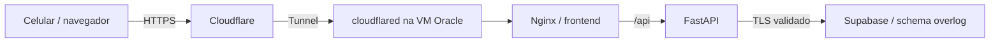

# Oracle Cloud + Cloudflare + Supabase

Esta configuração usa uma VM Oracle para frontend Nginx e API FastAPI, Cloudflare
Tunnel para publicar o domínio HTTPS e Supabase como PostgreSQL gerenciado.
O ambiente local continua independente. Não foi criada infraestrutura remota.



## 1. Recursos e acesso

- VM Oracle com SSH por chave, Docker Engine e plugin Docker Compose. Escolha a
  arquitetura, memória, região e orçamento na conta; não há garantia de capacidade
  Always Free. As imagens base atendem x86/ARM, mas o deploy deve ser validado na
  arquitetura da VM escolhida. Não exponha 5432, 8000 ou 8080 na Security List/NSG.
- Domínio ativo na Cloudflare e um túnel remotamente gerenciado. Defina um hostname,
  por exemplo `treinos.seudominio.com`, com serviço **HTTP `frontend:8080`**. O túnel
  e o frontend rodam na mesma rede Docker. Não use localhost como destino do túnel.
- Projeto Supabase com credenciais de PostgreSQL e certificado CA do endpoint.
  Não usamos `supabase-js`, Auth do Supabase ou a chave `service_role` no frontend:
  a autenticação e as regras de acesso continuam na API do OverLog.

Mantenha SSH acessível apenas aos endereços administrativos. O túnel usa conexões
saindo da VM; siga a documentação da Cloudflare para liberar a saída necessária
no firewall da Oracle e no host. Não é necessário abrir portas HTTP públicas na VM.

## 2. Conexão Supabase

No painel **Connect**, copie o host real e a porta, sem deduzir pelo nome da região.
Use conexão direta (5432) se a VM alcançar IPv6, ou **Session pooler (5432)** para
IPv4. Não use Transaction pooler (6543), pois esta aplicação usa estado de sessão
PostgreSQL, opções de conexão e cursores. No Session pooler, o usuário é
`postgres.PROJECT_REF` para migração e `overlog_app.PROJECT_REF` para a API.
Na conexão direta, são `postgres` e `overlog_app`.

Baixe o certificado CA do endpoint no painel do Supabase/provedor. Copie-o para a
VM e informe `SUPABASE_CA_FILE`. A configuração valida certificado e hostname com
`sslmode=verify-full`. Para endpoint que usa CA pública, informe um bundle de CAs
compatível. Não desabilite a verificação para contornar erro de certificado.

No SQL Editor, como `postgres`, execute `deploy/supabase-prepare.sql`, substituindo
o placeholder da senha por uma senha aleatória exclusiva de ao menos 16 caracteres.
O script cria `overlog` e o login restrito `overlog_app`; execute uma única vez em
projeto novo. Não envie a versão com senha ao Git. Em projeto que já contém esses
objetos, revise o estado antes de aplicar; o script não substitui roles existentes.

Mantenha `overlog` fora de **Exposed schemas** da Data API. Se não usar a Data API
para outro sistema, desative-a no painel. Nunca coloque nossas tabelas em schemas
públicos expostos para contornar problemas de conexão. Não fazemos alterações nos
schemas internos `auth`, `storage` ou nos objetos administrados pelo Supabase.

## 3. Preparar a VM

Após o push do código, clone o repositório na VM e copie o exemplo:

```bash
git clone https://github.com/CaioSantdev/OverLog.git
cd OverLog
cp .env.cloud.example .env.cloud
chmod 600 .env.cloud
```

Preencha `.env.cloud` na VM. Use chave JWT aleatória, domínio HTTPS sem barra final,
credenciais distintas de migração/runtime, host e CA correspondentes ao endpoint.
Guarde o token do túnel somente nesse arquivo. O backend não recebe credenciais de
migração; elas só entram no container temporário de manutenção. Não há portas
publicadas por `compose.cloud.yaml`. Para previsibilidade, fixe a imagem cloudflared
em versão ou digest validado na VM antes da publicação definitiva.

## 4. Migrar schema e conceder permissões

Faça backup antes de atualizar um projeto que já tenha dados. Com a API parada:

```bash
docker compose --env-file .env.cloud -f compose.cloud.yaml config --quiet
docker compose --env-file .env.cloud -f compose.cloud.yaml build
docker compose --env-file .env.cloud -f compose.cloud.yaml --profile maintenance run --rm migrate
```

Depois, execute `deploy/supabase-grants.sql` no SQL Editor como `postgres`. Ele
revoga acesso às tabelas para as roles da Data API e libera apenas leitura e as
escritas operacionais para `overlog_app`, sem CREATE, DROP ou TRUNCATE. Reaplique
após futuras migrações que criem tabelas. Só então inicie o app:

```bash
docker compose --env-file .env.cloud -f compose.cloud.yaml up -d --wait backend frontend tunnel
docker compose --env-file .env.cloud -f compose.cloud.yaml logs --tail=60 backend tunnel
```

O estado saudável do frontend não confirma a conexão do túnel: confira também
`Healthy` no painel Cloudflare, a URL pública e a resposta de `/api/health`.
Configure regra de cache da Cloudflare para **bypass `/api/*`** e preserve cookies,
Origin e cabeçalhos de segurança. Assets com hash podem usar cache normalmente.
Faça cadastro, crie um plano, finalize um treino, saia e entre de novo pelo domínio
HTTPS. Teste em uma conta separada; não publique credenciais de teste.

## 5. Dados existentes, atualização e rollback

A configuração não copia nem apaga o banco local. Migrar contas/treinos requer uma
etapa específica para transportar as tabelas do OverLog de `public` para `overlog`,
preservando IDs e relações; não restaure um dump completo do PostgreSQL local por
cima dos schemas gerenciados do Supabase. Defina essa escolha antes do primeiro
cadastro público. Faça a importação em projeto de teste e valide contagens e login.

Para atualizar: backup, anote o commit em uso, pare o backend, faça checkout do novo
commit, build, migrações, grants e subida. Reverter apenas o commit não desfaz uma
migração de banco; use backup/estratégia de migração revisada para mudanças destrutivas.
Backups e retenção do Supabase dependem do plano; mantenha uma cópia externa dos
dados e valide a restauração. As senhas e o JWT existentes podem ser preservados
numa migração planejada; não reutilize a chave JWT de desenvolvimento em produção.

Os limites por endereço observam o proxy Docker, então usuários podem compartilhar
uma janela. Os limites por e-mail e usuário permanecem independentes. Não habilite
confiança irrestrita em cabeçalhos de IP; regras de borda e uma cadeia de proxies de
confiança devem ser configuradas quando houver necessidade de escala.

## Fontes oficiais

- [Conexões e TLS do Supabase](https://supabase.com/docs/guides/database/connecting-to-postgres)
- [Schemas personalizados](https://supabase.com/docs/guides/api/using-custom-schemas)
- [Cloudflare Tunnel](https://developers.cloudflare.com/tunnel/get-started/)
- [Parâmetros do cloudflared](https://developers.cloudflare.com/cloudflare-one/networks/connectors/cloudflare-tunnel/configure-tunnels/run-parameters/)
- [Recursos Always Free da Oracle](https://docs.oracle.com/en-us/iaas/Content/FreeTier/freetier_topic-Always_Free_Resources.htm)

## Validação local da preparação

110 testes de backend e quatro fluxos de integração passaram. O Compose da nuvem
foi validado com valores fictícios, sem conectar às contas dos provedores. Em
PostgreSQL descartável, as sete migrações criaram as tabelas e os 94 exercícios em
`overlog`, preservando o schema `public`; os scripts de permissões foram conferidos
com uma role restrita. Os parâmetros de TLS e nomes de schema têm testes próprios.
A conexão TLS ao endpoint real, ARM, o túnel e a URL HTTPS pública ainda dependem
da infraestrutura e precisam ser validados durante a publicação.
